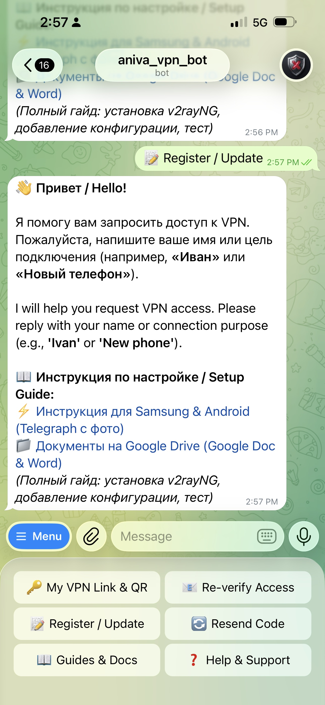
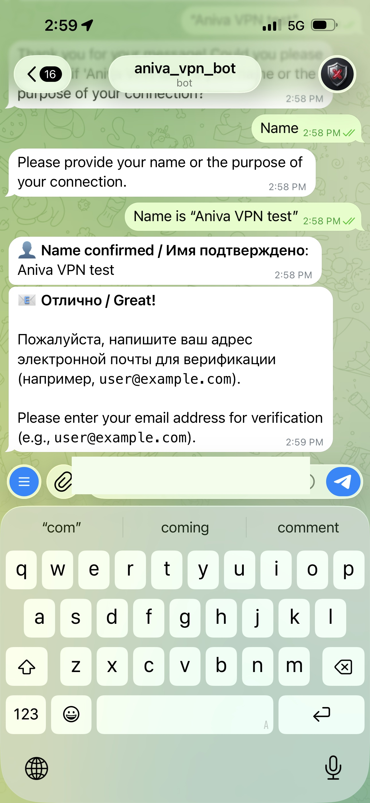
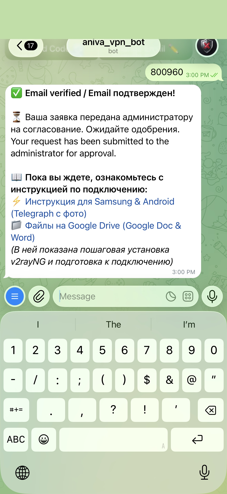
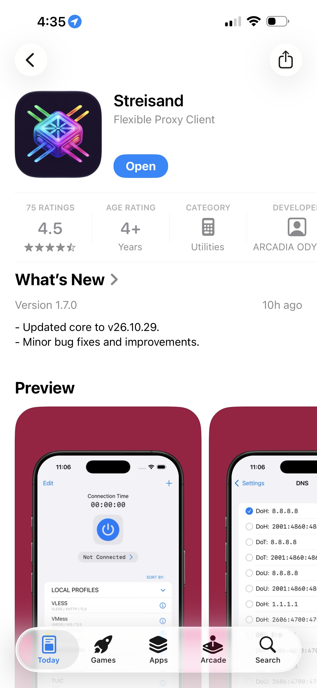
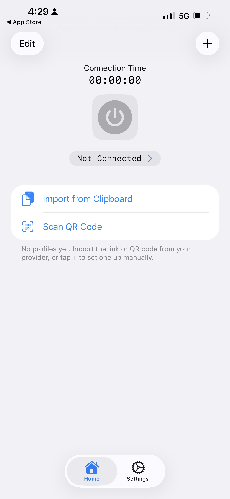
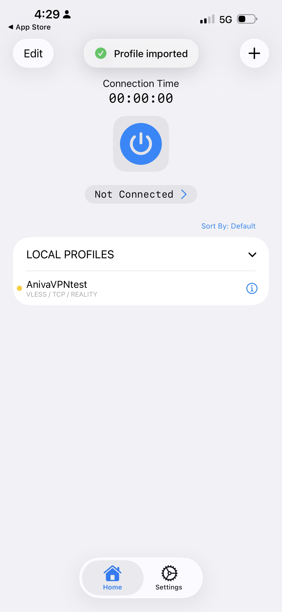
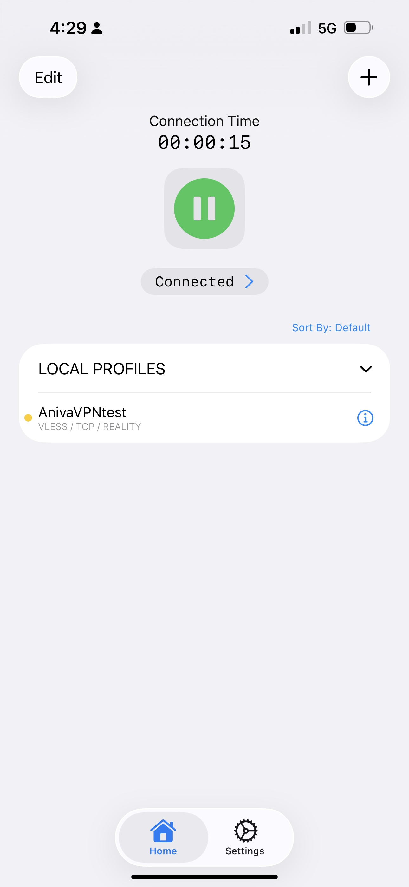

# Инструкция по настройке Aniva VPN на Apple iPhone и iPad (iOS)
# Apple iPhone & iPad (iOS) Setup Guide for Aniva VPN (VLESS Reality)

> **Назначение документа**: Пошаговое руководство со скриншотами для подключения к защищённому VLESS Reality VPN на устройствах Apple iPhone и iPad (iOS 16 / 17 / 18).

---

## Быстрые ссылки / Quick Links
* ⚡ **Telegram-бот для регистрации**: [@aniva_vpn_bot](https://t.me/aniva_vpn_bot)
* 🍏 **Клиент в App Store**: [Streisand (Flexible Proxy Client)](https://apps.apple.com/app/streisand/id6450534064)
* 📦 **Альтернативный клиент**: [V2Box (App Store)](https://apps.apple.com/app/v2box-v2ray-client/id6446814690)
* 📁 **Файлы в Google Drive**: [Папка с документами](https://drive.google.com/drive/folders/1QMJMLHJLOcFJ9EkEhYxRrTsX6ZZ78Zko?usp=drive_link)

---

## Содержание / Table of Contents
1. [Этап 1: Регистрация через Telegram-бота](#этап-1-регистрация-через-telegram-бота)
2. [Этап 2: Установка клиента Streisand из App Store](#этап-2-установка-клиента-streisand-из-app-store)
3. [Этап 3: Копирование ключа подключения](#этап-3-копирование-ключа-подключения)
4. [Этап 4: Импорт настроек в Streisand](#этап-4-импорт-настроек-в-streisand)
5. [Этап 5: Подключение и проверка связи](#этап-5-подключение-и-проверка-связи)
6. [Частые вопросы и тонкая настройка iOS](#частые-вопросы-и-тонкая-настройка-ios)

---

## Этап 1: Регистрация через Telegram-бота

1. Откройте Telegram на iPhone и перейдите в бота: **[@aniva_vpn_bot](https://t.me/aniva_vpn_bot)**.
2. Нажмите **Start** (или кнопку меню **«📝 Register / Update»**).
3. Бот попросит ввести:
   * **Ваше имя или устройство** (например, `iPhone Alexey`).
   * **Ваш Email** (для отправки 6-значного кода подтверждения).
4. На указанный email придёт 6-значный проверочный код. Отправьте этот код боту.
5. Бот подтвердит почту и передаст заявку администратору на одобрение.

---

## Этап 2: Установка клиента Streisand из App Store

Для работы с протоколом **VLESS Reality** на iOS используется лучший открытый и бесплатный клиент без рекламы — **Streisand** (или **V2Box**).

1. Откройте **App Store** на iPhone.
2. Перейдите по прямой ссылке:  
   👉 **[Установить Streisand из App Store](https://apps.apple.com/app/streisand/id6450534064)**  
   *(Либо введите в поиске App Store: `Streisand Flexible Proxy Client`)*.
3. Нажмите **Загрузить / Get** и подтвердите установку через Face ID / Touch ID / код-пароль.

---

## Этап 3: Копирование ключа подключения

После одобрения заявки администратором бот пришлёт три сообщения:
1. **Обзорное сообщение**: ссылки на инструкции и клиенты.
2. **Отдельное сообщение с ключом VLESS**:  
   `vless://...`  
   > 💡 **Как скопировать**: Просто **нажмите один раз** на блок с ссылкой в Telegram. Появится уведомление *«Текст скопирован в буфер обмена»*. Скопируется **только чистый ключ**, без лишнего текста!
3. **QR-код**: для сканирования камерой, если настраиваете с экрана другого устройства.

---

## Этап 4: Импорт настроек в Streisand

1. Откройте установленное приложение **Streisand**.
2. При первом запуске на главном экране отображаются две крупные кнопки:
   * **«Import from Clipboard»** (Импорт из буфера обмена)
   * **«Scan QR Code»** (Сканировать QR-код)
3. Нажмите **«Import from Clipboard»**.
4. При запросе iOS *«Streisand запрашивает разрешение на вставку из Telegram»* нажмите **Разрешить вставку (Allow Paste)**.
5. Вверху появится зелёная плашка **«Profile imported»**, а в списке **LOCAL PROFILES** отобразится добавленный сервер (например, `AnivaVPNtest`).

---

## Этап 5: Подключение и проверка связи

1. Убедитесь, что рядом с импортированным профилем стоит метка выбора.
2. Нажмите на большую круглую кнопку питания по центру экрана (кнопка включения).
3. При первом подключении появится стандартный системный диалог iOS:
   * **«Streisand запрашивает разрешение на добавление конфигураций VPN»** $\rightarrow$ нажмите **Разрешить (Allow)**.
   * Введите свой **код-пароль разблокировки iPhone**.
4. Кнопка станет **зелёной** с надписью **«Connected»**, а в строке состояния iPhone (рядом с часами или в Пункте управления) появится значок **[VPN]**.
5. Таймер соединения начнёт отсчёт (`Connection Time 00:00:15`).

---

## Частые вопросы и тонкая настройка iOS

### 1. Как включить постоянный VPN (Connect on Demand)
Чтобы VPN автоматически переподключался при смене Wi-Fi на сотовую сеть 5G/LTE:
1. В **Streisand** перейдите во вкладку **Settings** внизу экрана.
2. Убедитесь, что переключатель **Connect On Demand** включен.

### 2. Как проверить реальную работу VPN
1. Откройте Safari на iPhone.
2. Зайдите на сервис проверки IP: **[https://ipinfo.io](https://ipinfo.io)** или **[https://2ip.ru](https://2ip.ru)**.
3. Город и провайдер должны отображать адрес сервера Aniva VPN, а все защищённые и заблокированные ресурсы должны открываться мгновенно.

### 3. Альтернативный клиент: V2Box
Если Streisand по какой-либо причине недоступен в вашем Apple ID, используйте проверенный клиент **V2Box**:
1. Установите **[V2Box из App Store](https://apps.apple.com/app/v2box-v2ray-client/id6446814690)**.
2. Скопируйте ссылку VLESS из Telegram.
3. В V2Box откройте вкладку **Configs** $\rightarrow$ нажмите **`+`** в правом верхнем углу $\rightarrow$ выберите **«Import v2ray uri from clipboard»**.
4. Перейдите на вкладку **Home** и переведите переключатель в положение **Connected**.
